# AoE3 Blender Tools

A toolkit for making game-ready buildings and units for Age of Empires III mods, in the style of
the art a mod already has. It has two parts:

- **An art survey** (`tools/art_survey.py`): it reads the models, textures and anim files of the
  game and of a mod, and reports their conventions: budgets, texture sizes, attach point names,
  anim file structure, and which stock parts the mod reuses. The generators are calibrated on it.
- **A Blender add-on**: generators that build models from exact primitives (flat walls, straight
  edges), lay out one UV atlas, paint the texture from the real measurements, check that the
  result is game-ready, and export it. Four styles so far: neoclassical, Spanish colonial,
  European timber framing and African (Sub-Saharan and Sahel, thirteen building types).

| White House | Courthouse |
|---|---|
|  |  |
| **Capitol** | **Mansion** |
|  |  |
| **White House, medium detail** | **The same, geometry only** |
|  |  |
| **Colonial house** | **Colonial trading house** |
| 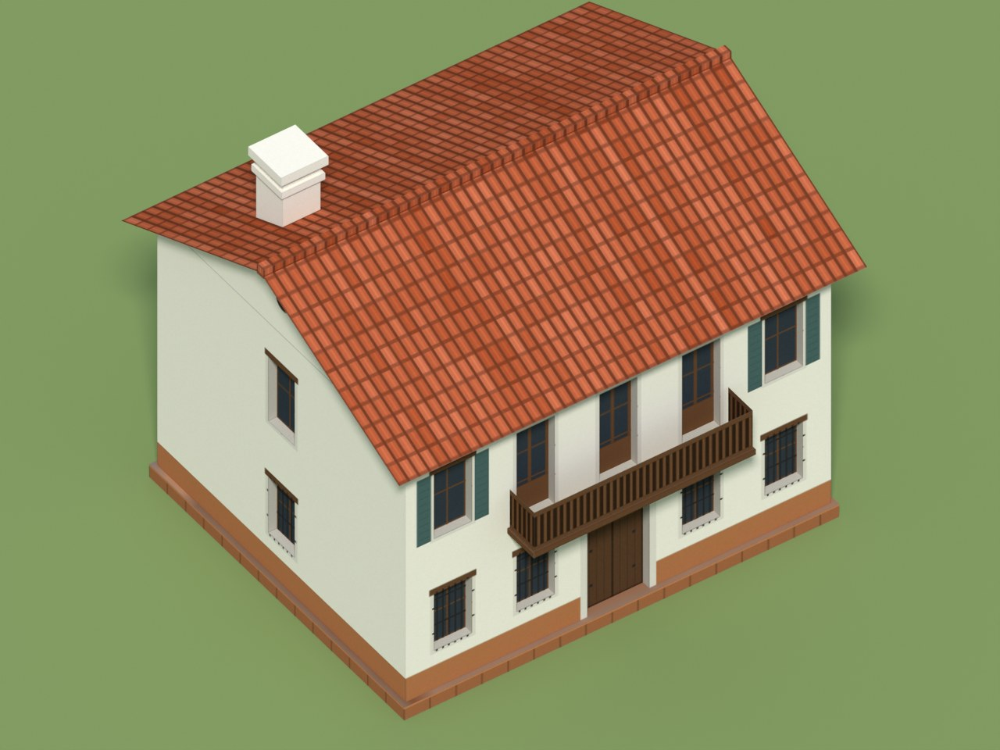 | 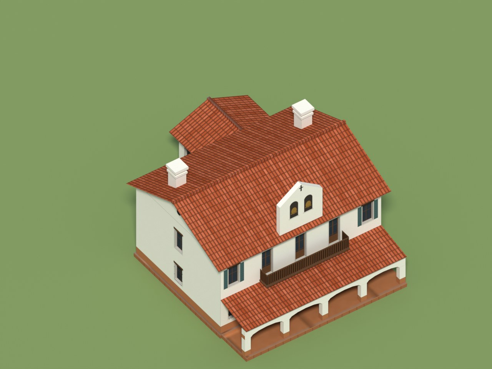 |
| **Timber house** | **Timber inn** |
| 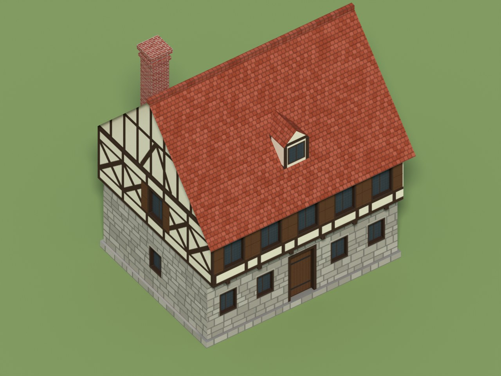 | 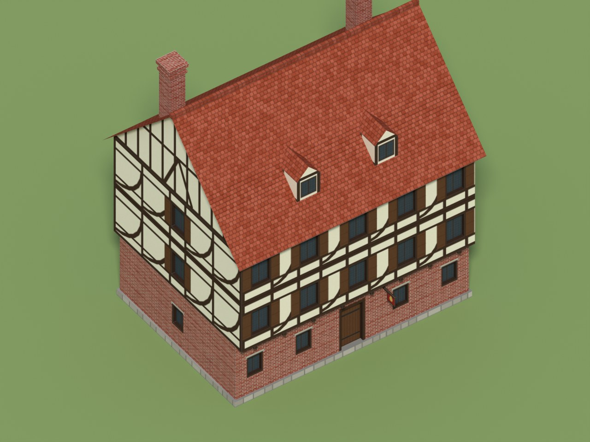 |
| **African house, Sub-Saharan** | **African house, Sahel** |
| 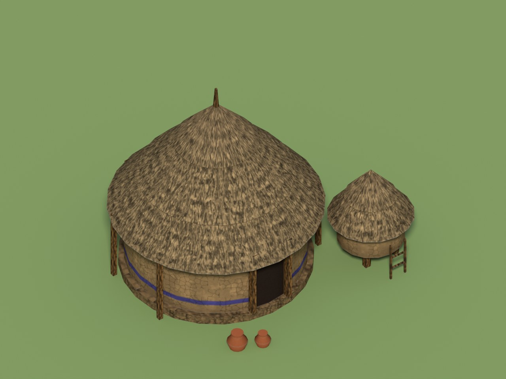 | 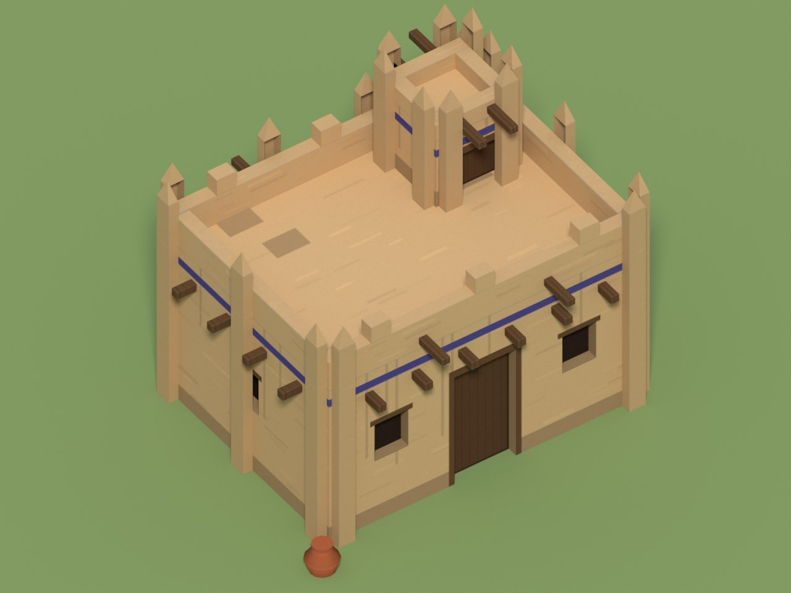 |
| **African palace, Sub-Saharan** | **African palace, Sahel** |
| 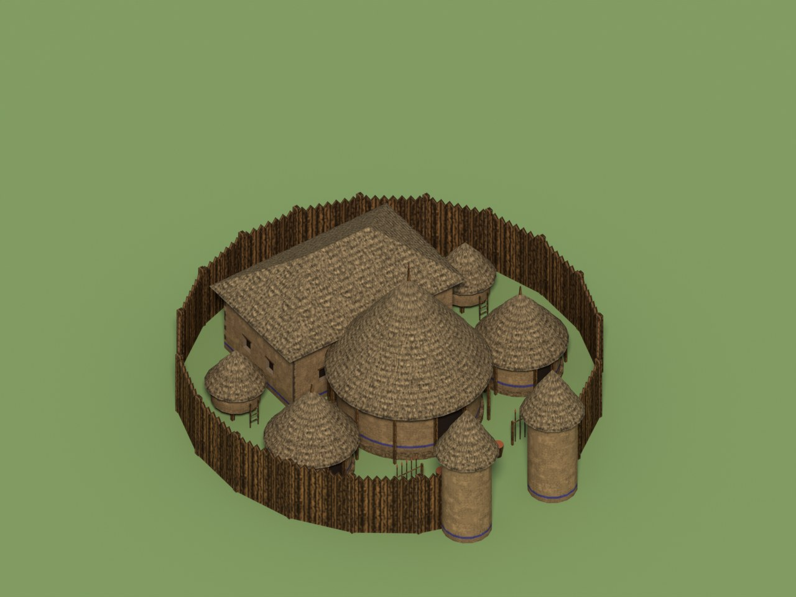 | 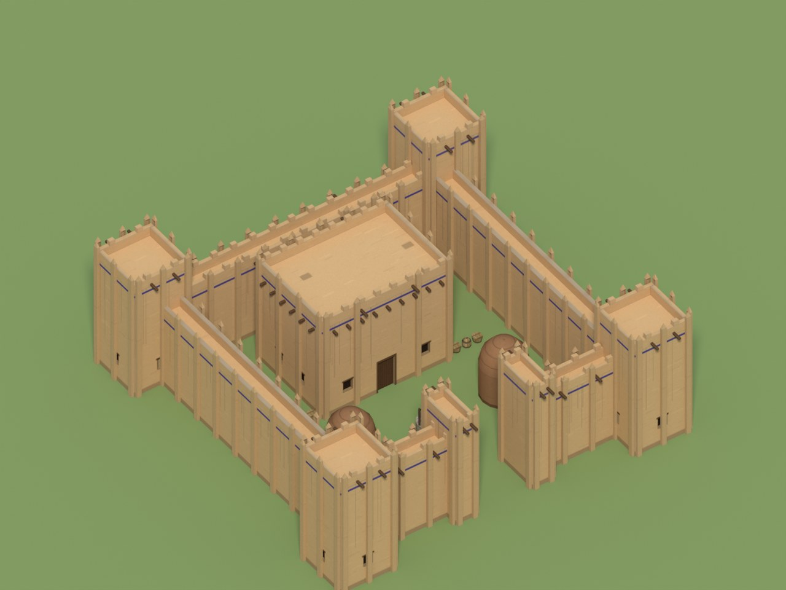 |

The four presets at low detail have 92 to 413 triangles; the White House at medium detail has
1,235. The colonial house has 362 triangles at medium detail, the trading house (a portal of
arches, a balcony, a bell gable and a wing) 646; the timber house 426, the inn (three storeys,
two dormers, a sign) 725. Each has one 1024 × 1024 texture.

The African style, all 30 presets (13 building types in two architectures, the stone stockade and
the two-storey customs house), each sized to the obstruction radius of the building it stands for
and, at medium detail, within 15 % of the median triangles of the target mod's own models of
its footprint class (602 for the Sahel granary to 4,776 for the Sahel palace):

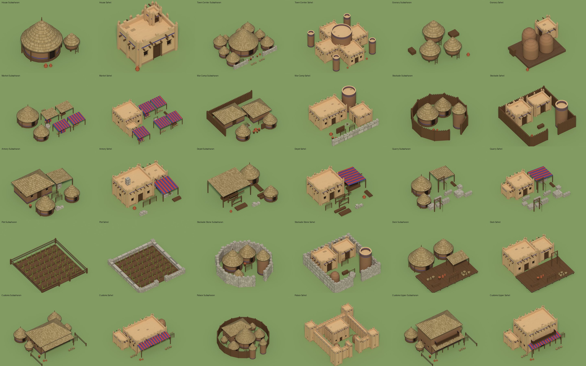

**White House, 1914** (preset `WHITE_HOUSE_1914`, built from a reference picture): north and south
elevations, then views from the south-west and the north-east. 3,035 triangles at medium detail,
one 2048 × 2048 texture, 44.5 × 23.6 m with the wings. The game's ground is flat, so the basement
that the real site shows on the south is left out.


Status: version 0.2. The add-on writes the game's own formats (Granny model, `.ddt` texture,
anim file, proto entry and strings), and a deployment script puts them into a test copy of the
game. In the game the generated White House stands at the right size among stock buildings,
shows the owner's colour, has its own icon and portrait, is built by villagers through the stock
construction stages and leaves stock rubble when destroyed
([docs/game-test.md](docs/game-test.md)). The survey has run on the game and a mod, and its
measurements calibrate the sizes and budgets.

**In the game** (the White House at medium detail, in a test copy of a mod): the same building for
two players, with the string courses in each owner's colour; built by a villager through the
stock construction stages; destroyed, leaving the stock rubble.


The colonial house in the same copy, for two players (shutters and door in the owner's colour),
beside a stock house:

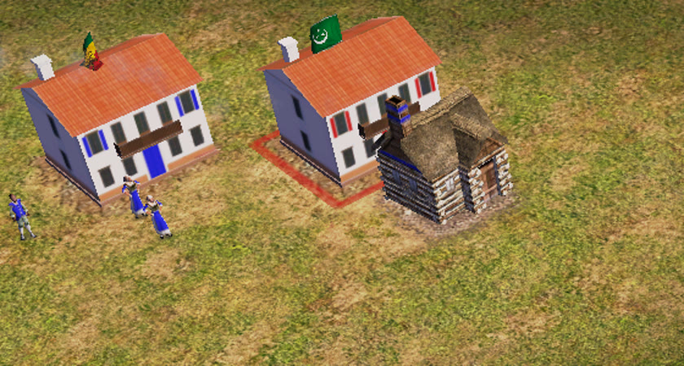

The timber house with its material swatches, for two players (shutters and door):

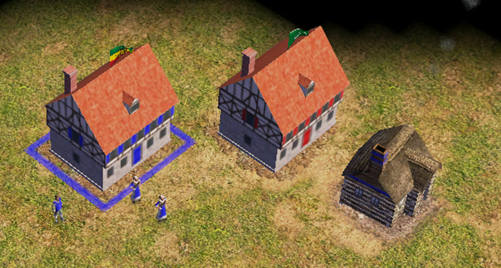

The four new presets deployed together (colonial house, colonial trading house, timber house,
timber inn):

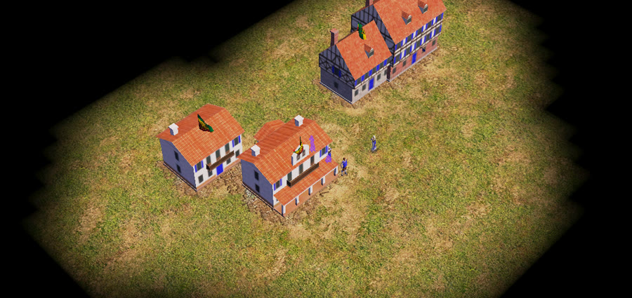

The Sahel palace among the other African buildings in the test copy (the copy's profile uses the
low models, so these are the low-detail ones):

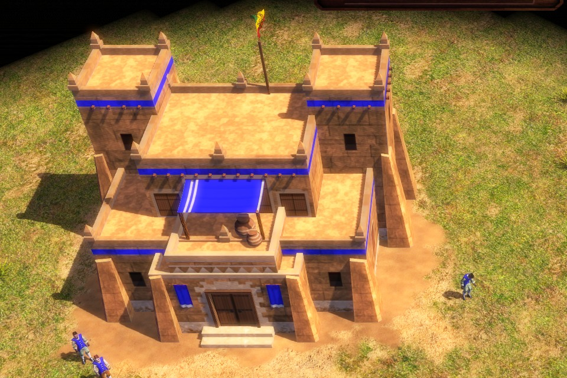

## Why

AI 3D generators make a building as a sculpted surface: decimated to a game budget, its walls come
out wavy and its windows warped. The buildings of a 2007 RTS are the opposite: a few hundred to a
few thousand triangles of simple, straight geometry, with the detail painted in the texture. This
add-on builds them that way. The details are in [docs/building-guidelines.md](docs/building-guidelines.md).

## Art survey

Read-only, standard library only, so it runs with any Python 3 on the machine that has the game:

```
python -I tools/art_survey.py "<game folder>" --bar --out survey/stock --label Stock
python -I tools/art_survey.py "<mod folder>" --bar --out survey/mod --reference survey/stock/report.json
```

`--bar` reads the `.bar` archives in memory; nothing is extracted. Each run writes `report.json`
and `summary.md`: counts, anim files per folder, how many of the mod's anim files reuse stock
files, own files or both, the most referenced files, reference kinds, attach point and bone names,
logic types, anim names, texture sizes and formats from the `.ddt` headers, and the elements of
the anim files. The reports hold measurements and paths, never file contents, but they name the
mod's files: keep them out of public repositories.

With `--proto <data\protoy.xml>` it joins every building to its anim file and finished model and
measures the model (triangles, vertex layout, size, basis, bones, texture, shader). Uncompressed
models are read directly; compressed ones (almost all) need `--granny <tool> --cache <folder>`,
an external tool that loads the game's own Granny runtime and rewrites a model uncompressed
(`<tool> rebake --install <game> --file <in> --out <out> --noop`). `--profile-out` writes the
calibration profile (measurements only): `aoe3_blender_tools/profiles/buildings.json` is the
target mod's.

```
python -I tools/art_survey.py "<game copy>" --bar --proto "<game copy>\data\protoy.xml" --granny <tool> --cache <folder> --out survey/mod --profile-out aoe3_blender_tools/profiles/buildings.json
```

## Features

- **AI repaint** (optional, local): a button repaints the texture with Stable Diffusion XL and a
  ControlNet in a local ComfyUI, region by region, for a hand-painted look; the edges, the
  player colour and the alpha stay where they were (a guard keeps any region whose edges move).
  See [docs/ai-textures.md](docs/ai-textures.md) for the install, the licences and the settings.
  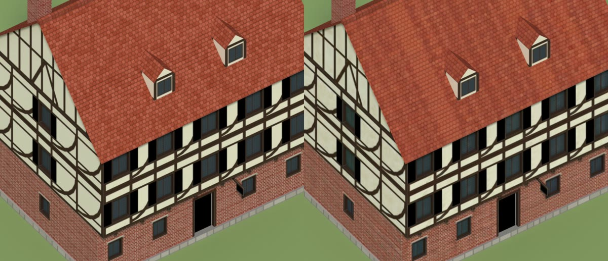
- **Spanish colonial style**: whitewashed walls on a low plinth with a coloured dado, small
  windows with iron grilles, shutters and a plank door in the owner's colour, a clay tile roof
  (two slopes along or across, or hipped) with a wide eave, and as options a wooden balcony, a
  portal along the front (wooden posts, or masonry piers with flat arches) under a lean-to roof,
  a bell gable that carries the flag, and an L plan with a one-storey wing. Presets: Colonial
  House, Colonial Trading House.
- **European timber-framed style**: a ground floor of rubble stone, brick or timber, upper floors
  of timber framing (posts, rails, cross or curved braces) over plaster or brick infill jutting out
  on joists, a steep tiled roof with framed gables, dormers on the front slope, brick chimneys and
  a hanging sign in the owner's colour. Presets: Timber House, Timber Inn.
- **African style**: a building type (house, town center, granary, market, war camp, stockade,
  armory, depot, quarry, plot, dock, customs house, palace) and an architecture. Sub-Saharan:
  round mud huts with tiered thatch cones and finials, granaries on stilts, palisades, open
  sheds, hill compounds. Sahel: adobe blocks with parapets, merlons and projecting beams, dome
  granaries, towers and a crenellated fortress. Props at medium detail (baskets, sacks, pots,
  drums, spear racks, log piles, wells, fires, cut stone, a shear-legs crane, millet on the
  ridges of a plot). Player colour on wall bands, awnings and doors. Each type takes the exact
  obstruction radius and proto template of the stock building it stands for. Presets:
  `AFRICAN_<TYPE>_<SUBSAHARAN|SAHEL>`, `AFRICAN_STOCKADE_STONE_*`, `AFRICAN_CUSTOMS_UPPER_*`.
- **Neoclassical style**: width, depth, 1 to 4 storeys, plinth, window
  spacing and side windows, a portico with 2 to 8 columns and a pediment, a hipped roof of any
  pitch, a cupola or a flagpole, up to 8 chimneys, a semicircular back portico (columns on an arc
  around a bowed bay, with a balustraded flat roof), wings (one-storey pavilions joined by
  colonnades), shutters, and alternating window caps. Presets: White House, Courthouse, Capitol,
  Mansion, White House 1914.
- **Values that cannot be built are reduced, with a warning**: more columns than the front holds,
  a bow too large for the back, chimneys that would overlap. A random sweep of 1,200 option sets
  passes the checks.
- **Two detail levels.** Low: flat walls with painted windows (about 350 triangles). Medium
  (about 1,200): windows and doors recessed into the walls, a balustrade with posts on the roof
  edge, a profiled cornice, columns with a base and a capital, cheek walls beside the steps and
  banded chimneys. The walls stay one polygon with holes, triangulated without T-junctions.
- **Painted texture**: stone courses, quoins, windows with sash bars and caps, the door with its
  fanlight, slate rows, dentils, brick, all aligned with the geometry. Colours are settings. Flat
  colour, no baked lighting. Painted with numpy only, so nothing extra is installed in Blender.
- **Material swatches** (option, off by default; `--materials` on the command line): small
  tileable CC0 photos under the painting give the walls their grain while every drawn detail
  and the colours stay; the swatch's lighting is removed and its grain scaled to a measured
  target (less on tiles and slates). Five swatches: plaster and ashlar for walls, rough stone for
  plinths and slate, clay for tiles, wood grain for timber. The bump map is made from the
  finished texture, so it carries the grain too. Credits in
  [aoe3_blender_tools/materials/MATERIALS.md](aoe3_blender_tools/materials/MATERIALS.md).
- **Game-ready check**: triangle budget, the 16-bit vertex limit, one UV map inside 0..1,
  power-of-two textures, material count, origin at the footprint centre and base on the ground,
  degenerate faces, hidden bottom faces, and overlapping coplanar faces (they flicker in game).
- **Export**: GLB and FBX with the texture embedded, OBJ + MTL, the texture as PNG, and a stats
  file. Attach points (`flag_attach` on the cupola) are exported as empties.
- **Game export**: the model as a Granny file (`.gr2`, in the stock buildings' basis, with a
  `bone_flag_civ` bone for the flag), the texture as `.ddt` (DXT3 by default, DXT1 or BGRA), the
  anim file (stock construction stages of the footprint class, ground decal) and `bundle.json`
  with the proto fields and strings. Sizes come from the calibration profile.
- **Low-poly and damaged models**: the LOW detail as the model for the game's "High Poly Models"
  option turned off (seen in game), and a damaged texture (soot, missing slates, cracks) for a building that has lost hit
  points (written; like the stock houses, the building looks intact with flames until it
  is destroyed, see docs/game-test.md).
- **Death animation**: the building sinks into the ground with the stock collapse dust before
  the rubble appears.
- **Notes for the mod's team**: `README.txt` and `proto_fields.xml` in each bundle say where every
  file goes and what the mod's own data still needs.
- **Icon and portrait**: rendered from the building, framed like the game's own (64 x 64 and
  128 x 128, DXT1).
- **Player colour**: an option paints the string courses and shutters for the owner's colour
  (texture alpha 0 there, as the stock textures mark it); the export then uses the game's
  player-colour shader.
- **Deployment** (`tools/game_deploy.py`, or Deploy to Test Copy and Undo in the add-on):
  copies a bundle into a test copy of the game, adds the unit and its strings and a builder for
  it, runs the mod's own validators, and undoes it all on request. It refuses any Steam folder.
- **Relief**: a bump map for each texture, made from its drawing (DXT5, as the game's own).
- **Calibrated checks**: with the profile, the triangle budget is the one measured for buildings
  of the same footprint.

## Install

Download or build the zip (`python tools/build_zip.py` writes `dist/`), then:

- **Blender 4.2 or later:** Edit > Preferences > Get Extensions > Install from Disk, and pick
  `aoe3_blender_tools-0.2.0.zip`.
- **Blender 3.6 to 4.1:** Edit > Preferences > Add-ons > Install, and pick
  `aoe3_blender_tools-0.2.0-legacy.zip`.

Tested with Blender 5.2 (as the `bpy` module, headless): install from the zip, generate, check and
export all work. The Blender 3.6 to 4.1 path is untested.

## Use

3D Viewport > Sidebar (N) > **AoE3**.

1. **Building Generator**: pick a preset and load it (or pick a **Style**: neoclassical,
   colonial or timber; the panel then shows that style's settings), change the settings, then
   **Generate Building**. Generating again replaces the object of the same name. When a setting
   cannot be built (for example more columns than the front allows), it is reduced and a warning
   says so. **Material swatches** lays the CC0 photos under the painting.
2. **Check and Export**: **Check** lists the problems of the active object; **Export** writes the
   files to the chosen folder (default `//aoe3_export`, next to the .blend).
3. **Game Export**: writes the bundle for the game (mod folder, name shown in game, proto
   template, texture format, icon, low-poly and damaged models) to the chosen folder (default
   `//aoe3_game`); **Deploy to Test Copy** puts it into a copy of the game, **Undo** takes it out.

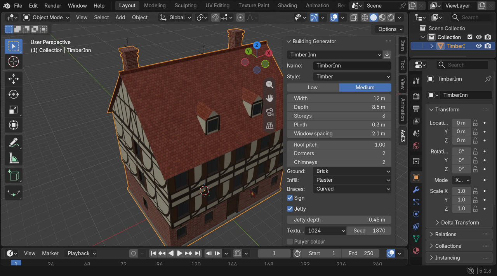

Conventions: 1 unit = 1 m, Z up, the front (portico) faces −Y, the origin is the centre of the
footprint (steps included) on the ground. GLB, FBX and OBJ are written Y-up.

## Command line

Everything also runs headless, with Blender or with the `bpy` module:

```
python -m venv venv
venv/bin/pip install bpy==5.2.3                       # Blender 5.2 as a module (Python 3.13)
venv/bin/python tests/run_tests.py                     # the test suite
venv/bin/python scripts/generate.py --preset ALL       # examples/<name>/ with exports and renders
venv/bin/python scripts/generate.py --preset WHITE_HOUSE --detail MEDIUM
venv/bin/python scripts/generate.py --preset WHITE_HOUSE_1914 --views front,back,front34,back34
venv/bin/python scripts/sweep.py --count 200                # random options through the checks
venv/bin/python scripts/generate.py --preset CAPITOL --out out --no-render
venv/bin/python scripts/game_export.py --out out/wh --preset WHITE_HOUSE --detail MEDIUM
python -I tests/test_game_formats.py                   # game formats, plain Python
venv/bin/python -I tests/test_golden.py               # presets byte for byte (--update-golden)
venv/bin/python -I tests/test_materials.py            # material swatches and their layer
venv/bin/python -I tests/test_comfy.py                # ComfyUI client (a stand-in server, no GPU)
venv/bin/python -I tests/test_airepaint.py            # AI repaint by regions (no GPU)
```

On Windows the venv's interpreter is `venv\Scripts\python`.

With a Blender install: `blender -b --factory-startup -P scripts/generate.py -- --preset ALL`.

## Getting a building into the game

Never write into the game's Steam folder: work in a copy of the game (or of the mod's folder).
The steps, the checks and what is still to see in game are in
[docs/game-test.md](docs/game-test.md); the formats are in [docs/game-formats.md](docs/game-formats.md).

```
venv\Scripts\python scripts\game_export.py --out out\wh --preset WHITE_HOUSE --detail MEDIUM --prefix <mod folder> --display "White House"
python -I -X utf8 tools\game_deploy.py --install <test copy> --bundle out\wh --validate
python -I tools\game_deploy.py --install <test copy> --undo
```

Then start the copy's game, open the scenario editor and place the building.

`tools/bar.py` lists and extracts the game's `.bar` archives, `tools/xmbedit.py` reads and
writes its compiled XML (`.xmb`), and `tools/gr2_tree.py` reads an uncompressed Granny model:
see [tools/README.md](tools/README.md).

## Roadmap

1. **Survey** (done): run on the game and a mod; the profile of the target mod ships with the
   add-on.
2. **Calibration and game formats** (done, in-game check in progress): sizes and budgets from
   the profile; `.gr2`, `.ddt`, anim file, proto and strings written and deployed. Next: see the
   building placed, built and destroyed in game; player colour; DXT textures.
3. **Buildings** (in progress): the kit of parts (done), the Spanish colonial and European timber
   styles (done, seen in game), material swatches (done) and death models (done). Next: Asian and
   native styles, forts, walls and gates, baking a detailed model's texture onto a clean mesh,
   and the other texture options in [docs/texture-plan.md](docs/texture-plan.md).
4. **Units:** reuse the stock skeletons and animations; build the body from parts or fit a
   detailed mesh to a stock skeleton; textures with the player-colour mask.

## License

GPL-3.0-or-later ([LICENSE](LICENSE)), as Blender requires for add-ons. The material swatches in
`aoe3_blender_tools/materials/` are CC0 1.0 (public domain) photos from the sources listed in
their `MATERIALS.md`. Age of Empires is a trademark of Microsoft; this project is not affiliated
with Microsoft.
