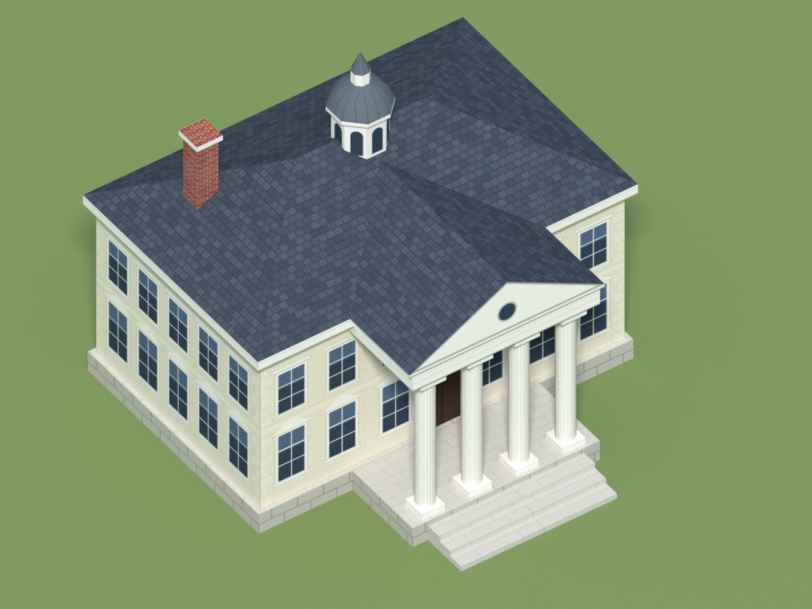
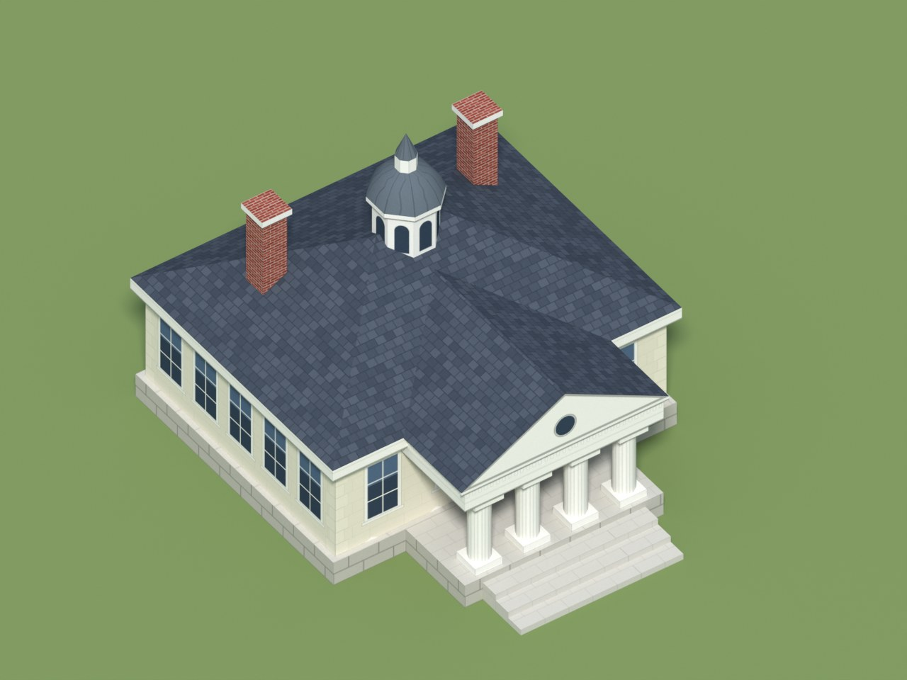
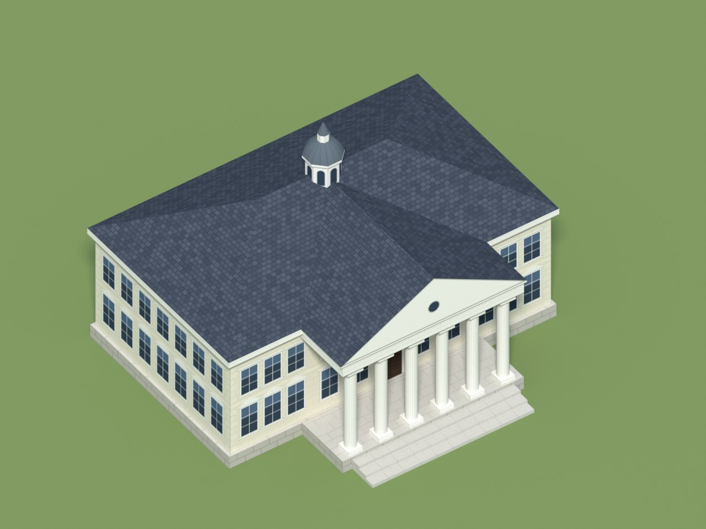
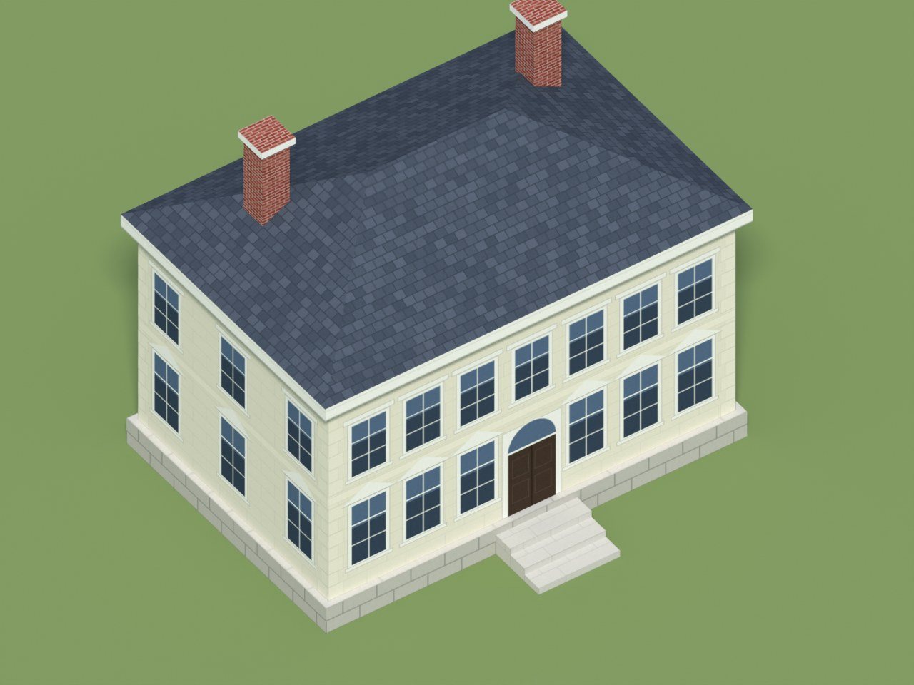
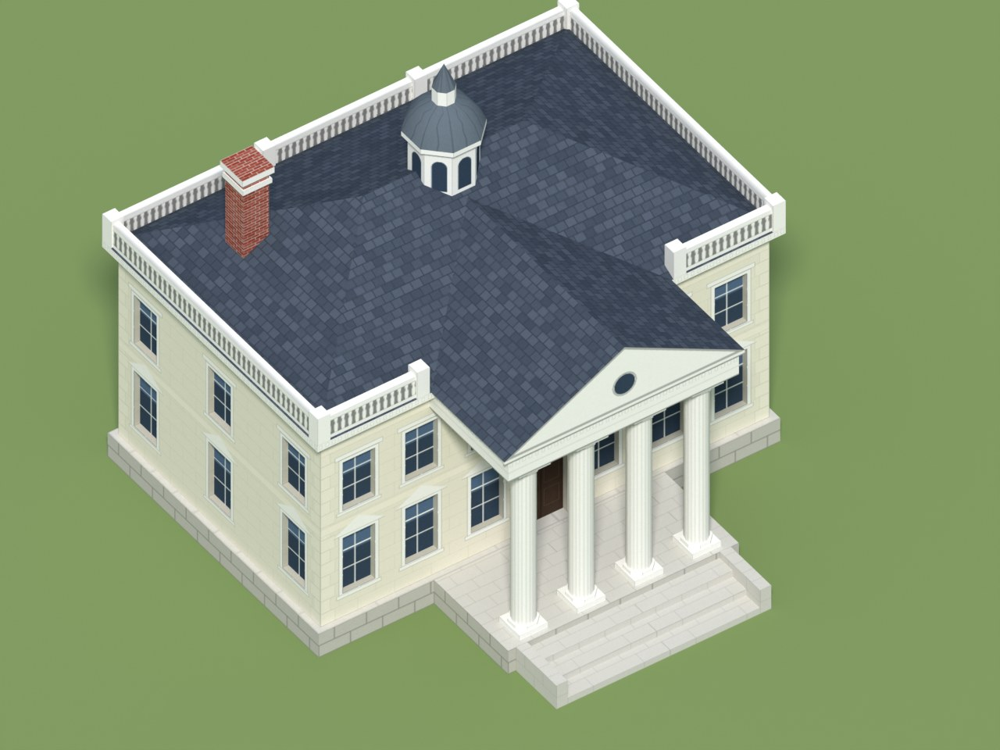
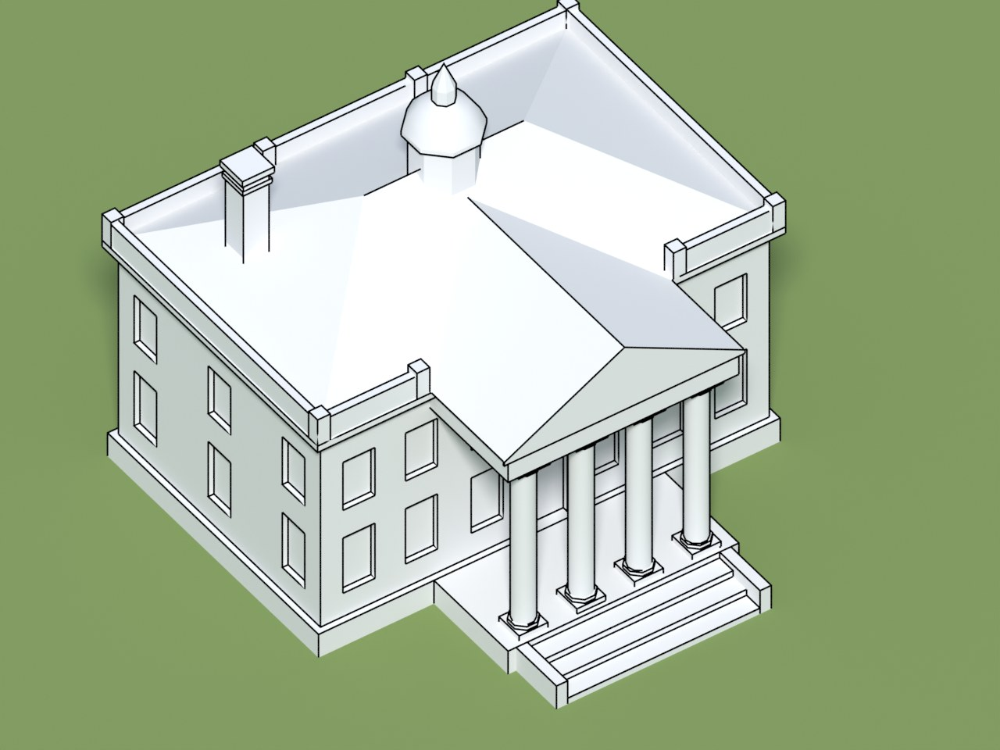
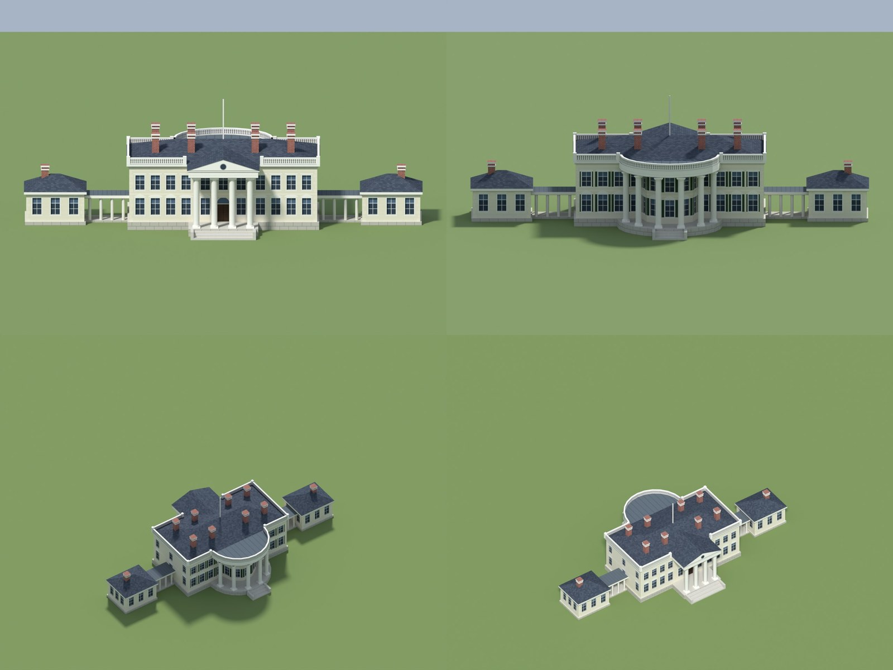
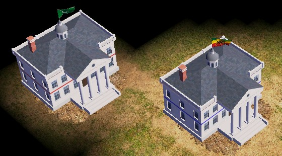
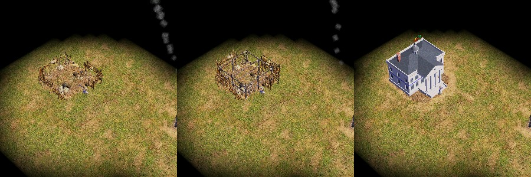
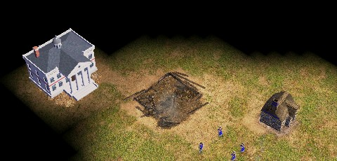

# AoE3 Blender Tools

A toolkit for making game-ready buildings and units for Age of Empires III mods, in the style of
the art a mod already has. It has two parts:

- **An art survey** (`tools/art_survey.py`): it reads the models, textures and anim files of the
  game and of a mod, and reports their conventions: budgets, texture sizes, attach point names,
  anim file structure, and which stock parts the mod reuses. The generators are calibrated on it.
- **A Blender add-on**: generators that build models from exact primitives (flat walls, straight
  edges), lay out one UV atlas, paint the texture from the real measurements, check that the
  result is game-ready, and export it. The first generator makes neoclassical buildings.

| White House | Courthouse |
|---|---|
|  |  |
| **Capitol** | **Mansion** |
|  |  |
| **White House, medium detail** | **The same, geometry only** |
|  |  |

The four presets at low detail have 92 to 413 triangles; the White House at medium detail has
1,235. Each has one 1024 × 1024 texture.

**White House, 1914** (preset `WHITE_HOUSE_1914`, built from a reference picture): north and south
elevations, then views from the south-west and the north-east. 3,035 triangles at medium detail,
one 2048 × 2048 texture, 44.5 × 23.6 m with the wings. The game's ground is flat, so the basement
that the real site shows on the south is left out.



Status: version 0.2. The add-on writes the game's own formats (Granny model, `.ddt` texture,
anim file, proto entry and strings), and a deployment script puts them into a test copy of the
game. In the game the generated White House stands at the right size among stock buildings,
shows the owner's colour, has its own icon and portrait, is built by villagers through the stock
construction stages and leaves stock rubble when destroyed
([docs/game-test.md](docs/game-test.md)). The survey has run on the game and a mod, and its
measurements calibrate the sizes and budgets.

**In the game** (the White House at medium detail, in a test copy of a mod): the same building for
two players, with the string courses in each owner's colour; built by a villager through the
stock construction stages; destroyed, leaving the stock rubble.







## Why

AI 3D generators make a building as a sculpted surface: decimated to a game budget, its walls come
out wavy and its windows warped. The buildings of a 2007 RTS are the opposite: a few hundred to a
few thousand triangles of simple, straight geometry, with the detail painted in the texture. This
add-on builds them that way. The details are in [docs/building-guidelines.md](docs/building-guidelines.md).

## Art survey

Read-only, standard library only, so it runs with any Python 3 on the machine that has the game:

```
python -I tools/art_survey.py "<game folder>" --bar --out survey/stock --label Stock
python -I tools/art_survey.py "<mod folder>" --bar --out survey/mod --reference survey/stock/report.json
```

`--bar` reads the `.bar` archives in memory; nothing is extracted. Each run writes `report.json`
and `summary.md`: counts, anim files per folder, how many of the mod's anim files reuse stock
files, own files or both, the most referenced files, reference kinds, attach point and bone names,
logic types, anim names, texture sizes and formats from the `.ddt` headers, and the elements of
the anim files. The reports hold measurements and paths, never file contents, but they name the
mod's files: keep them out of public repositories.

With `--proto <data\protoy.xml>` it joins every building to its anim file and finished model and
measures the model (triangles, vertex layout, size, basis, bones, texture, shader). Uncompressed
models are read directly; compressed ones (almost all) need `--granny <tool> --cache <folder>`,
an external tool that loads the game's own Granny runtime and rewrites a model uncompressed
(`<tool> rebake --install <game> --file <in> --out <out> --noop`). `--profile-out` writes the
calibration profile (measurements only): `aoe3_blender_tools/profiles/buildings.json` is the
target mod's.

```
python -I tools/art_survey.py "<game copy>" --bar --proto "<game copy>\data\protoy.xml" --granny <tool> --cache <folder> --out survey/mod --profile-out aoe3_blender_tools/profiles/buildings.json
```

## Features

- **Building generator** (neoclassical for now): width, depth, 1 to 4 storeys, plinth, window
  spacing and side windows, a portico with 2 to 8 columns and a pediment, a hipped roof of any
  pitch, a cupola or a flagpole, up to 8 chimneys, a semicircular back portico (columns on an arc
  around a bowed bay, with a balustraded flat roof), wings (one-storey pavilions joined by
  colonnades), shutters, and alternating window caps. Presets: White House, Courthouse, Capitol,
  Mansion, White House 1914.
- **Values that cannot be built are reduced, with a warning**: more columns than the front holds,
  a bow too large for the back, chimneys that would overlap. A random sweep of 1,200 option sets
  passes the checks.
- **Two detail levels.** Low: flat walls with painted windows (about 350 triangles). Medium
  (about 1,200): windows and doors recessed into the walls, a balustrade with posts on the roof
  edge, a profiled cornice, columns with a base and a capital, cheek walls beside the steps and
  banded chimneys. The walls stay one polygon with holes, triangulated without T-junctions.
- **Painted texture**: stone courses, quoins, windows with sash bars and caps, the door with its
  fanlight, slate rows, dentils, brick, all aligned with the geometry. Colours are settings. Flat
  colour, no baked lighting. Painted with numpy only, so nothing extra is installed in Blender.
- **Game-ready check**: triangle budget, the 16-bit vertex limit, one UV map inside 0..1,
  power-of-two textures, material count, origin at the footprint centre and base on the ground,
  degenerate faces, hidden bottom faces, and overlapping coplanar faces (they flicker in game).
- **Export**: GLB and FBX with the texture embedded, OBJ + MTL, the texture as PNG, and a stats
  file. Attach points (`flag_attach` on the cupola) are exported as empties.
- **Game export**: the model as a Granny file (`.gr2`, in the stock buildings' basis, with a
  `bone_flag_civ` bone for the flag), the texture as `.ddt` (DXT3 by default, DXT1 or BGRA), the
  anim file (stock construction stages of the footprint class, ground decal) and `bundle.json`
  with the proto fields and strings. Sizes come from the calibration profile.
- **Low-poly and damaged models**: the LOW detail as the model for the game's low model detail
  setting, and a damaged texture (soot, missing slates, cracks) for a building that has lost hit
  points.
- **Icon and portrait**: rendered from the building, framed like the game's own (64 x 64 and
  128 x 128, DXT1).
- **Player colour**: an option paints the string courses and shutters for the owner's colour
  (texture alpha 0 there, as the stock textures mark it); the export then uses the game's
  player-colour shader.
- **Deployment** (`tools/game_deploy.py`): copies a bundle into a test copy of the game, adds
  the unit and its strings, runs the mod's own validators, and undoes it all on request. It
  refuses any Steam folder.
- **Calibrated checks**: with the profile, the triangle budget is the one measured for buildings
  of the same footprint.

## Install

Download or build the zip (`python tools/build_zip.py` writes `dist/`), then:

- **Blender 4.2 or later:** Edit > Preferences > Get Extensions > Install from Disk, and pick
  `aoe3_blender_tools-0.2.0.zip`.
- **Blender 3.6 to 4.1:** Edit > Preferences > Add-ons > Install, and pick
  `aoe3_blender_tools-0.2.0-legacy.zip`.

Tested with Blender 5.2 (as the `bpy` module, headless): install from the zip, generate, check and
export all work. The Blender 3.6 to 4.1 path is untested.

## Use

3D Viewport > Sidebar (N) > **AoE3**.

1. **Building Generator**: pick a preset and load it, change the settings, then **Generate
   Building**. Generating again replaces the object of the same name. When a setting cannot be
   built (for example more columns than the front allows), it is reduced and a warning says so.
2. **Check and Export**: **Check** lists the problems of the active object; **Export** writes the
   files to the chosen folder (default `//aoe3_export`, next to the .blend).
3. **Game Export**: writes the bundle for the game (mod folder, name shown in game, proto
   template, player colour) to the chosen folder (default `//aoe3_game`).

Conventions: 1 unit = 1 m, Z up, the front (portico) faces −Y, the origin is the centre of the
footprint (steps included) on the ground. GLB, FBX and OBJ are written Y-up.

## Command line

Everything also runs headless, with Blender or with the `bpy` module:

```
python -m venv venv
venv/bin/pip install bpy==5.2.3                       # Blender 5.2 as a module (Python 3.13)
venv/bin/python tests/run_tests.py                     # the test suite
venv/bin/python scripts/generate.py --preset ALL       # examples/<name>/ with exports and renders
venv/bin/python scripts/generate.py --preset WHITE_HOUSE --detail MEDIUM
venv/bin/python scripts/generate.py --preset WHITE_HOUSE_1914 --views front,back,front34,back34
venv/bin/python scripts/sweep.py --count 200                # random options through the checks
venv/bin/python scripts/generate.py --preset CAPITOL --out out --no-render
venv/bin/python scripts/game_export.py --out out/wh --preset WHITE_HOUSE --detail MEDIUM
python -I tests/test_game_formats.py                   # game formats, plain Python
```

On Windows the venv's interpreter is `venv\Scripts\python`.

With a Blender install: `blender -b --factory-startup -P scripts/generate.py -- --preset ALL`.

## Getting a building into the game

Never write into the game's Steam folder: work in a copy of the game (or of the mod's folder).
The steps, the checks and what is still to see in game are in
[docs/game-test.md](docs/game-test.md); the formats are in [docs/game-formats.md](docs/game-formats.md).

```
venv\Scripts\python scripts\game_export.py --out out\wh --preset WHITE_HOUSE --detail MEDIUM --prefix <mod folder> --display "White House"
python -I -X utf8 tools\game_deploy.py --install <test copy> --bundle out\wh --validate
python -I tools\game_deploy.py --install <test copy> --undo
```

Then start the copy's game, open the scenario editor and place the building.

`tools/bar.py` lists and extracts the game's `.bar` archives, `tools/xmbedit.py` reads and
writes its compiled XML (`.xmb`), and `tools/gr2_tree.py` reads an uncompressed Granny model:
see [tools/README.md](tools/README.md).

## Roadmap

1. **Survey** (done): run on the game and a mod; the profile of the target mod ships with the
   add-on.
2. **Calibration and game formats** (done, in-game check in progress): sizes and budgets from
   the profile; `.gr2`, `.ddt`, anim file, proto and strings written and deployed. Next: see the
   building placed, built and destroyed in game; player colour; DXT textures.
3. **Buildings:** a kit of parts per architectural style found in the survey (colonial, European,
   Asian, native, forts, walls and gates), damage and death models, and baking the texture of a
   detailed model onto a clean mesh. Textures: relief baking, material swatches, Stable
   Diffusion with ControlNet and the other options in [docs/texture-plan.md](docs/texture-plan.md).
4. **Units:** reuse the stock skeletons and animations; build the body from parts or fit a
   detailed mesh to a stock skeleton; textures with the player-colour mask.

## License

GPL-3.0-or-later ([LICENSE](LICENSE)), as Blender requires for add-ons. Age of Empires is a
trademark of Microsoft; this project is not affiliated with Microsoft.
