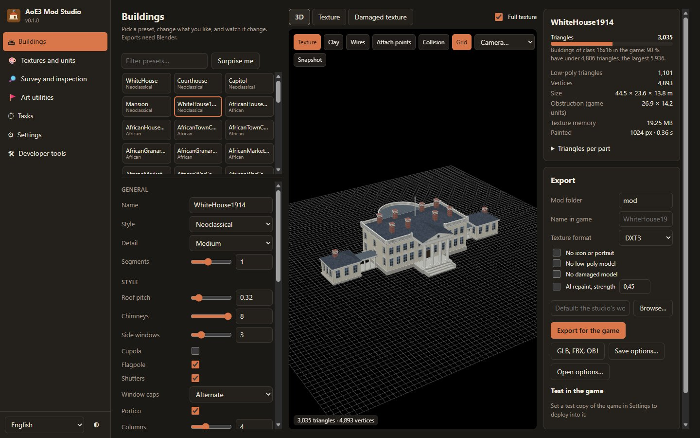

# AoE3 Mod Studio

Every tool of this repository behind one window, as forms instead of command lines, in English or
Spanish. It is meant for modders who use neither Blender nor a terminal.

## Start it

- **From the repository** (Python 3.10 or newer with numpy; the venv works):
  `venv\Scripts\python -m studio`. It opens its own window (Edge or Chrome in application mode)
  and stops when that window closes. `--no-window` serves it only, `--port N` picks the port.
- **As a program**: `python -I tools/build_app.py --zip` (with a Python that has `pyinstaller`
  and `numpy`, not the venv with `bpy`) writes `dist/AoE3ModStudio/AoE3ModStudio.exe` and a zip of
  about 60 MB. Unzip it anywhere and run the executable: no Python needed. Windows shows a
  SmartScreen warning the first time, as for any program that is not signed.

The settings (the game, the mod, the test copy, Blender, the Granny bridge, ComfyUI, the work
folder) are kept in `%APPDATA%\aoe3-blender-tools\studio.json`. Nothing leaves the computer.

## What it does

| Screen | What is there |
|---|---|
| Buildings | Every preset; a form drawn from `core/schema.py` that shows only what the chosen style uses; the model in 3D with its texture, in clay, with its wires, attach points and collision boxes, a person 1.8 m tall for the scale, the obstruction on the ground, the low-poly model, the damaged texture, the player colour of a team; the texture with its atlas regions; triangles against the style's target or the game's buildings of the same class; the technical sheet; **Check** (the add-on's game-ready checks, `scripts/check.py`); with the PROP style, the prop sets side by side and their export; the AI repaint region by region (below); export for the game, GLB/FBX/OBJ with renders; deploy to the test copy and undo. **Settlements and more forms** leads to the settlement composer (below) and the buildings' forms |
| Textures and units | **Repaint a unit** and **Make a tileable texture** (below); the UV atlas, the recipe tool, LoRA dataset and training as forms |
| Survey and inspection | The art, texture, model, grouping, shape and palette surveys; style check; contact sheets; a file inspector (`.ddt` as a picture with its header and alpha, `.gr2` in 3D with its bones and the texture beside it, `.xmb` as XML, `.bar` as a searchable list whose files open the same way); `.xmb` to XML and back; **a survey's results** as a table (below) |
| Art utilities | **Design a civ flag** (below); avatar icons, ground rings, health bars, missing letters in a font, the HITPOINTBAR fix, bone scale fix, uncompressed models |
| Settings | The folders, checked as they are chosen; what the studio found; Start and Check ComfyUI (the nodes and models a repaint needs); the log. The **welcome** opens on the first start until the game's folder is set |
| Tasks | Every task of the session with its live log, progress, cancel and outputs (pictures shown, text files opened, folders shown) |
| Developer tools | Technical sheets, sweep, galleries, AI sweep, the painter's fit, swatch download, add-on zips |

Every command-line tool has its form (`studio/catalog.py`; `tests/test_studio.py` fails when a
script has none, or when a form passes an option its script does not read). Every option says
what it does, its unit and its default, in both languages (`studio/catalog_help.py` for those the
catalog declares without help; a test fails on an option left without it).

## The screens made for their task

A form is enough to run a survey; it is not enough to paint. Six screens work in the studio's
own process and answer as you move a control (a ComfyUI step runs in a thread, a write as a task):

- **Repaint a unit** (`studio/retex.py`, `web/js/retex.js`). A unit of the game copy (as
  `tools/uv_atlas.py` finds its model and texture) or a model file; its texture with the UV
  islands, coloured by body part on demand. Click an island to add it to the step being edited
  (Ctrl or Alt: take it out), a part's button for the whole part, Shift and drag for a box. Steps
  are those of `tools/retexture.py` (recolour, hue and tone, fill with a swatch, paste a design,
  smooth, cloth grain, player colour, AI) with sliders and colour pickers, painted live on the
  picture and on the unit in 3D (`retexture.paint`, split out of `run` with the same result).
  A step with no selection yet paints nothing instead of failing. **Write** saves the recipe, the
  atlas and the pictures in a folder of the work folder and runs the retexture tool: the .ddt in
  the chosen format, the bump map, a sheet of before and after; the AI steps run there.
- **Design a civ flag** (`studio/flags.py`, `web/js/flags.js`). The copy's flag sets measured once
  (`make_flag.survey` and the state colour fits), then any design, cropped by Shift and drag,
  shown as all ten textures (`make_flag.set_images`, split out of `make_set`) next to one of the
  copy's sets; written beside the copy, never into it, with its preview sheet.
- **Make a tileable texture** (`studio/texmaker_ui.py`, `web/js/texmaker.js`). A photograph (any
  format the browser reads: the page sends it as PNG, the studio needs no image library), the
  square to use moved with sliders or Shift and drag, the texture made at once without ComfyUI
  (`texmaker.make(client=None)`), tiled 3 by 3, the join before and after, its distance to the
  mod's own textures of that material; kept in the library with its licence (refused without
  one); the library with its pictures; **Use it in the buildings** puts it under the painter
  (`texlib.install`) for this studio's previews and exports, and back. With ComfyUI, the repaint
  runs as `tools/make_texture.py`.
- **AI repaint, region by region** (a card of the Buildings screen; `studio/airepaint_ui.py`,
  `web/js/airepaint.js`). Each region with the material ComfyUI is asked for; all, walls, roofs or
  one by one; strength, seed, mix, an own description, the edge guard. The model shows each
  region as it is done; **Stop** ends it between two regions (and interrupts ComfyUI). **Use it
  for the export** keeps the texture as a PNG that `scripts/game_export.py --texture-png` puts in
  place of the painted one; a change to the building drops it.
- **A survey's results** (`studio/results.py`, `web/js/results.js`). A texture or model survey's
  report (`textures.json`, `models.json`: the profile is computed with the survey's own
  `profile()`) or a profile (`--profile-out`, or this program's own in
  `aoe3_blender_tools/profiles/`) as a table: every group (origin, category, role, material) with
  its quartiles drawn as bars (the middle half and the median, each column on its scale), its
  shares, its palette and its most common sizes and formats; sorted by any column, filtered by a
  word. A finished survey offers **See the results**. Only groups are shown, which name no file.
- **Compose a settlement** (`studio/settlement_ui.py`, `web/js/settlement.js`). The units to lay out
  (class, proto, variations, radius), the socket and an obstruction ring; `core/settlement.compose`
  lays them as the mod's own settlements are (the counts default to the mod's medians, another seed
  gives another arrangement). A plan from above shows the clear ground and the free lane; a unit is
  dragged, turned by 15 degrees (wheel, Q and E) or edited by its numbers. **Open a grouping** reads
  any grouping file (`aoe3game/grouping.read`); **Write it** writes it in the work folder, keeping a
  read file's own width, height, flags, tiles and the orientation of every unit not turned (the
  1,483 groupings of a Wars of Liberty copy come back unit for unit); **Deploy** fills the grouping
  form with it and the test copy. Which way the game's x and z run on the plan, and a unit's
  facing, are still **to verify in game**: the screen says so.

## When something goes wrong

- **The log**: `%APPDATA%\aoe3-blender-tools\studio.log` keeps the start, every task and how it
  ended (a failed task with its last lines), and every error with its trace (three files of 1 MB at
  most). Settings shows it. A built program has no console: without it an error would be lost.
- **One studio at a time**: a second start finds the first through `studio.lock` (beside the
  settings) and opens a window on it.
- **The studio stops** a little after its last window closes (a reload, or a second window, keeps
  it), never while a task runs, and closes the browser it started. A page whose studio has stopped
  says so in a red bar, and recovers if it starts again on the same address.

## How it is built

- `studio/server.py`: a standard-library HTTP server on 127.0.0.1 only. The API writes files and
  starts programs, so each call carries a token the page gets when it loads, and the Host and
  Origin headers must name the server (no other site, no DNS rebinding). The page's content
  security policy allows its own scripts only.
- `studio/engine.py`: the generator in the studio's own process, `core` imported as a top-level
  package as the tools do, so Blender never loads. A preview is `building.build`, `paint.paint`
  and `core/gamemesh.py`'s mesh: 0.01 to 0.03 s of geometry, 0.03 s (White House) to 1 s (African
  town centre) of painting at 256 px, the size used while a control moves.
- `studio/jobs.py`: each tool runs in its own process (they print, call `sys.exit`, change module
  globals, some start process pools): a live log, a real cancel (the whole process tree).
- `studio/blender_bridge.py`: what needs Blender (the game export's mesh and icons, GLB/FBX/OBJ,
  renders, `model_sheets`, `gallery`, `sweep`) runs with the `bpy` module when this Python has
  it, else with an installed Blender 4.2 or newer in the background
  (`blender -b --factory-startup -P <script> -- <options>`). Without either, those buttons say
  what is missing.
- Tests: `tests/test_studio.py` (the API, safety, every screen's engine, the forms against their
  scripts, both languages, the rule above) and `tests/test_studio_ui.py`, which opens every screen in
  a headless Edge or Chrome in English and Spanish (`tests/studio_ui.mjs`, Node 22+) and fails on a
  page error, a key shown untranslated, a page wider than the window or a screen that did not draw.
- `studio/web/`: the page, plain ES modules with no build step; three.js 0.160 (MIT) for the 3D
  view, vendored in `studio/web/vendor/`. Texts in `studio/web/i18n/en.json` and `es.json`; the
  catalog carries its own strings in both languages.

## Safety

- The studio never writes into the game's installation or a Steam library: every output path is
  checked (`settings.check_output`), and `tools/fix_hitpointbar_tags.py`,
  `tools/fix_bone_scale.py` and `tools/make_icons.py --install` now refuse a Steam library
  themselves, as `game_deploy.py` and `uncompress_models.py` already did.
- A tool that changes files in place has a trial (`--dry-run`, or the plan of
  `uncompress_models.py`); **Apply** is refused by the server until a trial of the same values has
  passed. A tool that changes the test copy without a trial asks first. Running the mod's own
  validators (`deploy --validate`) asks first: they are scripts inside the copy.
- An output the form leaves empty goes to the work folder, never to a tool's default inside this
  program.

## Measured (2026-11-17)

- The game export of WHITE_HOUSE at medium detail from the studio (venv, `bpy` module) is byte for
  byte the export of `scripts/game_export.py`.
- The built program (59 MB, no `bpy`) exported AFRICAN_HOUSE_SAHEL through the installed Blender
  5.2 in 12 s: the same 17 files; the model, texture, anim file and proto are byte for byte the
  same, the bump maps and the portrait differ on 0.01 % of their pixels (Blender's numpy 2.3
  against the venv's 2.5, and its renderer).
- A tool with a process pool (`texture_survey.py`) runs inside the built program: the executable
  runs a tool's script as a module by its name (`--run-tool`), so its workers load it again.
- `core/gamemesh.py` against Blender's game mesh, every preset at both details: the same
  triangles count, area, corner positions and UVs everywhere; the same vertices and normals in
  100 of the 102 cases.

- The made-to-measure screens on synthetic data: a unit's live repaint of three steps on a
  1024 px texture, 0.35 s; a texture made from a photograph without ComfyUI, 1.6 s (it works at
  1024 px before bringing it to the swatch size); a flag set of ten textures, well under a second.

## Every function reaches the studio

A rule of this repository (CLAUDE.md): a new function is not done until it can be used from the
studio, with its texts in English and Spanish and its test. Three lists hold it, each with a test
that fails when something is left out:

- every operator of the Blender add-on has its place in `studio/coverage.py` (a screen, a form, or
  pending with the reason): `every_operator_reaches_the_studio` in `tests/run_tests.py` and
  `EveryFunctionReachesTheStudio` in `tests/test_studio.py`;
- every script of `tools/` and `scripts/` has its form in `studio/catalog.py`;
- every `BuildingParams` field is described in `core/schema.py`.

What the add-on does that the studio does not do yet:

| Operator | Why |
|---|---|
| `aoe3.pack_set` | It packs meshes modelled in Blender into one texture; the studio has no meshes of its own to pack yet |

The AI repaint of a mesh made elsewhere (the add-on's AI panel on any mesh) also waits: the studio
repaints its own buildings.

## Without Blender

- **Check** runs everywhere: without Blender, `scripts/check.py` applies the same rules to the
  generator's own mesh (`core/checks.py`; `core/validate.py` is now the Blender side of the same
  rules). The same findings on all 102 presets and details (`the_checks_without_blender_match_blenders`
  in `tests/run_tests.py`).
- **Export for the game, without Blender** (experimental): a box of the Export card (the only way
  when Blender is missing), and its own form (`scripts/game_export_noblender.py`, `--compare` lists
  how its bundle differs from one made with Blender). The mesh is `core/gamemesh.py`'s; the icon and
  portrait come from `core/softrender.py` (Blender's camera, its light fitted to Blender's: within
  4 / 255 on average); the low-poly and damaged variants as `blender_io.game_variants` makes them.
  Measured against Blender's bundles of four presets: textures, bump maps, anim file, proto and
  strings byte for byte; the models with the same vertices, normals and UVs (some flat quads cut
  along the other diagonal: rendered alike, under 0.3 % of the pixels differ). Whether it looks the
  same in game is **to verify** (`docs/game-test.md`); Blender stays the default until then.
- GLB, FBX and OBJ, the renders of `scripts/generate.py`, `model_sheets` and the galleries still
  need Blender.

## Still to do

- The bundle made without Blender, seen in game beside its Blender twin.
- The settlement composer's axes and facing, in game.
- A signed installer, and a first-run assistant beyond the welcome note.
